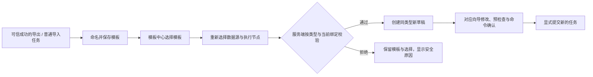

# 模板中心设计

> 文档状态：**按现役能力重定义；本地实现已接入，验收见任务地图；未用户定版或安装**\
> 更新日期：2026-11-02\
> 范围：现役导出与普通导入的配置复用；不将旁路导入的执行能力外推为模板能力\
> 页面规则：[模板中心 P1](../../design-system/pages/template-center.md)\
> 阶段与完成状态：[开发任务地图](../03-technical/development-task-map.md#template-center-redesign)

阅读导航：[模块定义](#module-design) · [字段规则](#field-rules) · [业务场景与验收](#business-scenarios) · [实现差距](#implementation-gaps)。

## 1. 定义与依据

模板中心保存**成功任务的可复用配置**，供用户重新选择数据源与执行节点后，创建同类型的可编辑新草稿。参数修改、环境核对、预检查、命令确认与提交由对应任务向导负责。

用户在这里完成三个判断：选哪个模板、用于哪个数据源、在哪个执行节点继续配置。模板名称可改，模板内容不可原地修改；需要调整配置时先创建草稿，在向导中修改，任务成功后另存新模板。

本方案依据当前源码、契约和已有证据重新定义范围，不以旧规划或已有页面替代事实。此次没有查询现役服务、升级数据库或运行真实工具，不能据此认定当前运行二进制与工作树一致。

| 核对对象 | 当前事实 | 权威入口 |
| --- | --- | --- |
| 导出模板 | 成功任务保存、列表、改名、删除、创建新草稿已接入；保存时剥离存储凭据引用 | [控制面模板链](../../internal/controlplane/server.go)、[通用导出契约](../03-technical/export-general-contract.md) |
| 普通导入模板 | 已接入同类型复用；清除源、节点、任务名称，保留路径及活动配置 | [复用契约](../03-technical/normal-import-contract.md#2026-10-19-草稿管理与历史配置复用)、[实现](../../internal/store/normal_import_reuse.go) |
| 类型边界 | 只允许 OBDUMPER_EXPORT、OBLOADER_NORMAL_IMPORT；旧导出 URL 仍只接受导出 | [0032 迁移](../../migrations/0032_task_config_templates.sql)、[路由类型核对](../../internal/controlplane/template_types.go) |
| 旁路导入 | 可执行和历史配置派生不构成模板能力；当前不提供旁路模板 | [旁路技术契约](../03-technical/direct-load-contract.md) |
| 权限 | 模板使用与管理分离；共享列表隐藏来源任务 ID；其他主体的模板创建仍未准入 | [权限配置契约](../03-technical/access-control-contract.md)、[权限谓词](../../internal/store/permission_templates.go) |
| 验证 | 导出模板链和普通导入模板链已有局部真实或合成记录；不代表本次新页面已验收 | [任务地图](../03-technical/development-task-map.md)、[复用闭环记录](../03-technical/evidence/task-import-reuse-2026-10-19.md) |

## 2. 当前范围与旧规划的替代关系

| 能力 | 本版定义 | 页面与实现边界 |
| --- | --- | --- |
| 从成功任务保存 | 保留，作为唯一创建来源 | 任务中心/详情按服务端 SAVE_TEMPLATE 资格提供入口；提交时再次核对可信成功与当前授权 |
| 导出、普通导入 | 保留，类型不可变 | 两类模板各进自身向导，不跨类型解释配置 |
| 选择数据源与节点 | 每次使用重新选择 | 不沿用来源绑定、不默认选择第一个候选；候选不等于任务可执行 |
| 改名、删除 | 保留 | 名称更新受 revision 保护；删除不回写已有草稿或历史任务 |
| 查找与浏览 | 名称搜索、类型筛选、分页 | 仅处理接口完整返回的当前授权摘要集合；不新建查询 API |
| 手工创建、复制模板、完整参数编辑 | 不进入本版 | 调整参数通过“创建草稿 → 向导修改 → 成功后另存”完成；不建立第二套参数表单 |
| 固定数据源策略 | 不进入本版 | 不增加策略字段、预选绑定或策略切换入口 |
| 兼容四态、差异页、重新校验服务 | 不进入本版 | 现有 DTO 无相应事实；创建草稿时由当前服务端校验，向导继续完成任务预检查 |
| 标签、描述、收藏、分享设置、修订历史 | 不进入本版 | 不增加字段、表、公开链接或版本流程；既有精确范围授权继续生效 |
| 旁路模板、定时执行、批量派生 | 不进入本版 | 不显示可操作占位项，不因其他模块已实现而默认准入 |

本次按用户“按现役产品状态，重新定义设计模板中心”的明确要求，替代旧 TP-R、TP-FR、TP-LF 中超出当前范围的规划。原编号及确认记录保留历史意义，见 DEC-026、DEC-027、DEC-039；现行规则使用 TP2 编号，避免将旧验收项误判为当前必备能力。安全、授权、不可变历史和不直接执行等边界继续保留。

名称去首尾空白后必填，当前服务端上限为 **256 个 UTF-8 字节**，不等同于 256 个汉字。现行存储没有模板名称唯一约束，本版允许重名，以不可变 ID 区分，不把旧“同创建人、同类型唯一”的建议变成事实。

## 3. 配置、环境与证据边界

| 内容 | 模板内处理 | 使用时处理 |
| --- | --- | --- |
| 类型、来源、能力版本、配置指纹 | 保留当前模型支持的安全事实 | 不从能力版本或指纹推断兼容成功 |
| 对象、内容、格式及活动参数 | 使用各类型现有领域模型的结构化配置 | 当前规则重新解释和校验，不读取旧命令还原配置 |
| 本地路径、控制文件路径等非秘密配置 | 按对应类型现有提取规则保留 | 原样传递，按所选平台检查；不转换盘符或补子目录 |
| 数据源与节点绑定 | 不作为可沿用的环境绑定 | 必须显式重选，并由服务端复验使用权限与事实 |
| 任务名称 | 不作为新任务名称复用 | 普通导入模板清除原名称；新任务名称由向导处理 |
| 密码、密钥、凭据与存储凭据引用 | 不复制 | 向导按当前引用和短生命周期解析取得；导出对象存储重新绑定 |
| 输入文件清单、对象目录、空间、连接结果 | 不复制既有环境证据 | 在新草稿中重新读取或预检查 |
| 预检查、风险确认、命令、租约、日志、进度、结果 | 不复制 | 由新任务流程重新产生 |

模板中心的列表、弹层和浏览器状态不接收配置 JSON，不为展示摘要新增原始配置读取接口。导出 query-sql 继续是受限于固定 OBDUMPER 信封的普通参数，不增加独立 SQL 通道，也不因模板使用增加 CAP_SENSITIVE_COMMAND 或提交级二次确认。

旧字段、旧能力或当前绑定不适用时，保留模板本身并阻断本次派生，显示安全原因；不得静默删字段、转换路径、降级格式或把普通导入配置当导出解析。候选列表与创建前结构校验均不代替文件、数据库或存储的任务预检查。

## 4. 字段与展示模型

### 4.1 安全摘要

当前列表返回完整的授权安全摘要及只读 availableActions，不返回配置内容、兼容状态或服务端分页信息。动作仅表示本模板当前使用/管理职责，不保证配置、目标绑定或任务可执行。字段只取自 [ConfigTemplateItem](../../web/src/api/browser.ts) 与控制面安全投影。

| 编号 | 字段 | 使用位置与约束 |
| --- | --- | --- |
| TP2-F001 | id | 行键、请求对象及可展开技术信息；不得用名称匹配或替代 |
| TP2-F002 | displayName | 列表主名称、弹层标题；长值安全截断且可访问完整文本 |
| TP2-F003 | taskType | 独立“任务类型”列，只显示“导出”或“普通导入”；未知值失败关闭 |
| TP2-F004 | sourceTaskId | “来源任务”列，只在接口返回时提供任务详情入口；空值显示“—” |
| TP2-F005 | updatedAt | “更新时间”列，复用当前产品时间展示；不可解析时不伪造时间 |
| TP2-F006 | capabilityVersion | 使用抽屉内按需展开的技术信息；不能重命名为“工具版本” |
| TP2-F007 | revision | 改名、删除的 If-Match 及会话绑定；不包装为模板发布版本 |
| TP2-F008 | createdAt | 按需展开的技术信息；列表沿用服务端创建时间倒序 |
| TP2-F009 | configFingerprint | 当前接口的内部配置身份；默认不展示，不代表验证通过 |
| TP2-F010 | keyword、taskTypeFilter、page | 页面临时浏览条件；不进入模板或任务配置 |
| TP2-F017 | availableActions | 只读 CREATE_DRAFT、RENAME、DELETE；缺失仅可读，未知或重复值拒绝，不授予底层引用权限 |

共享模板会隐藏来源任务 ID，因此缺失来源不能显示“手工创建”“原任务已删除”或“无权限”。模板可见也不代表来源任务可读；来源链接仍经过任务详情的正常授权，不预取隐藏内容。

列表不增加工具版本、参数元数据版本、环境、数据源策略、高风险标识、创建人或兼容状态列：当前摘要没有这些事实。不得固定填 4.3.5、从能力编码猜测，或通过逐项读取历史任务拼造列表事实。

### 4.2 操作输入

| 编号 | 输入 | 规则 |
| --- | --- | --- |
| TP2-F011 | 保存/改名的 displayName | 去首尾空白后非空、UTF-8 长度不超过 256 字节；允许重名；首次打开不报错 |
| TP2-F012 | 使用时 dataSourceId | 从当前类型的有权候选显式选择；为空不请求创建 |
| TP2-F013 | 使用时 nodeId | 从当前类型的有权候选显式选择；为空、候选读取中或已消失时不请求创建 |
| TP2-F014 | If-Match | 改名/删除必须使用当前模板 revision；冲突不覆盖 |
| TP2-F015 | Idempotency-Key | 保存模板/创建草稿的请求身份；同一次结果未确认的操作不得通过新键盲重试 |
| TP2-F016 | 技术信息展开状态 | 只控制显示现有安全摘要，不触发配置或秘密读取 |

名称搜索只匹配 displayName，类型筛选只接受两种已支持类型。完整列表读取成功后，前端可在该集合内筛选并按每页 10 条展示；总数仅为筛选后可见条数。保持服务端 created_at DESC、template_id DESC 顺序，不提供未经支持的服务端排序或任意游标。若以后接口改为有界分页，必须同步改用服务端筛选与分页，禁止继续把一页当全集。

## 5. 从任务保存模板

1. 任务列表/详情依据服务端 SAVE_TEMPLATE 资格显示“保存为模板”；旁路、失败、取消、核对中及不支持快照不因前端判断而开放。
2. 打开轻量命名弹窗，显示来源任务名称与任务类型，唯一输入为“模板名称”。用紧凑说明保存配置、排除凭据与运行证据、使用时重新绑定和检查；不复制参数编辑器或完整命令。
3. 提交前验证名称，提交时锁定该命名会话并防重；服务端复验任务终态、版本、授权、CSRF 与来源配置。
4. 确认成功后关闭弹窗、清除输入，以短时 Ant Message 提示“模板已保存”。留在来源任务页面，不额外导航；用户通过现有模板中心入口使用。
5. 明确失败保留当前名称供修改或重试；失权、对象变化和卸载立即使旧会话失效。结果不确定按第 9 节处理，不能直接再次保存。

保存表示完成配置复用对象的持久化，不表示当前环境、数据源或工具能力已再次验证。改动配置后保存为另一个模板必须经过新任务成功，不能将未执行草稿伪装为成功来源。

## 6. 使用模板创建草稿

“使用模板”打开右侧抽屉，取代当前列表下方的第二块常驻创建区域。抽屉只负责目标绑定，不编辑模板内容，不在打开时创建草稿或发起真实预检查。

1. 捕获模板 ID、taskType、revision 与页面会话代号，再按类型并行读取数据源和节点。
2. 导出直接复用 exportDataSourceEligibility 与导出节点候选；普通导入直接复用 normalImportRules 与自身授权节点列表。不能复制一份资格判断或借用另一任务类型的候选。
3. 两份候选全部成功后原子发布。初次均不预选；数据源按现有规则筛选，节点显示“名称 · 操作系统 · CPU 架构”。候选可选只代表可继续配置。
4. 用户选择数据源和节点后，显式点击“创建草稿”。请求只含 dataSourceId、nodeId，模板类型由已选摘要与服务端共同核对。
5. 服务端按当前类型、领域配置和绑定重新校验。拒绝时留在抽屉，展示可行动的安全原因；不回退旧绑定、不静默改配置、不自动打开一个空白任务。
6. 成功响应必须匹配模板 ID 与任务类型；导出进入 `/exports/new?draft=<id>&step=1`，普通导入进入 `/imports/normal/new?draft=<id>&step=1`。草稿是已保存的新对象，进入对应向导重新审阅。
7. 后续凭据绑定、路径/文件、对象、权限、生产/高风险确认和预检查全部由向导负责，最终仍核对脱敏完整命令并显式提交。

节点下拉每次展开强制重读候选；刷新时保留控件，禁止创建。相同 ID 改名保留选择，ID 消失则清除，不按同名替换。读取任一失败时清除候选与绑定并允许重读，不以部分结果恢复创建资格。

关闭抽屉会放弃本地绑定选择，没有持久化草稿时无需“丢弃参数”确认。创建请求在途时锁定提交与关闭操作；路由变化或卸载仍须隔离响应，不能声称取消已接受的服务端写入。结果不确定时切换到明确的“创建结果待确认”，不保持一个无期限的 loading。

## 7. 改名、删除与历史关系

- “改名”使用轻量弹窗，不在表格内展开第二套表单。未变化时不写入；成功提示“模板已改名”，更新当前摘要；明确失败保留当前输入；冲突先刷新并由用户重新决定，禁止静默覆盖。
- “删除”沿用 OrchDangerConfirm，显示安全名称及“删除后无法再使用此模板；已创建的草稿和任务不受影响”。取消不发送请求；确认后使用 If-Match，成功才从列表移除。
- 删除失败或冲突时不乐观移除；重新核对授权与 revision，不能自动改成归档、强制删除或级联删除来源任务。
- 改名不修改模板内容、类型、已有草稿和任务；删除不回写历史。当前创建草稿响应带 templateId，但草稿/任务没有完整持久模板来源版本链，本版不承诺动态同步或“由此模板创建的任务”列表。

## 8. 权限与失败关闭

列表按现有角色和精确范围读取，再投影当前模板的 availableActions。CREATE_DRAFT 只表示模板使用职责；RENAME、DELETE 只表示模板管理职责。二者互不替代，也不授予来源任务、数据源或节点权限；写接口和仓储事务继续复验当前事实。

当前部署仍按固定管理员首版处理。其他主体的模板创建与真实跨身份业务联调没有因本轮开放；共享列表继续隐藏来源任务 ID。安全依赖缺失、未知动作、畸形或重复资格失败关闭，旧服务没有 availableActions 时仅显示摘要，不从可见或所有者名称猜测写权限。

401/403 立即清除旧目录、弹层、绑定和提示，并使此前在途的目录读取失效；后来返回的旧成功和普通网络故障均不能恢复操作。只有新的成功授权读取才可解除阻断。无权对象与不存在保持同一 404 语义，不展示隐藏名称、数量、来源或失败原因差异。

## 9. 接口、事务与异步规则

### 9.1 复用现有接口

| 动作 | 当前接口 | 关键边界 |
| --- | --- | --- |
| 列表 | GET /api/v1/config-templates | 两类安全摘要及当前模板动作资格；无配置 JSON、服务端分页或兼容四态 |
| 从成功任务保存 | POST /api/v1/tasks/{id}:save-template | body 只有 displayName；CSRF、幂等与可信成功来源 |
| 改名 | PATCH /api/v1/config-templates/{id} | body 只有 displayName；If-Match；配置不可变 |
| 删除 | DELETE /api/v1/config-templates/{id} | If-Match；独立管理授权与审计 |
| 创建草稿 | POST /api/v1/config-templates/{id}:create-draft | body 只有 dataSourceId、nodeId；按真实类型进入独立草稿链 |

旧 export-config-templates 路径保持导出边界。OpenAPI 中历史手工创建/详情声明不表示已实现，本版不调用这些入口；仅为最小操作资格投影同步 OpenAPI，不新增路由、迁移、机器信封或命令能力，不扩展为完整 CRUD。

现有短事务、授权、revision、审计及幂等规则继续由控制面和仓储负责，页面不拼命令、不读取执行节点文件、不解析秘密，也不直接发起数据库/存储测试。

### 9.2 会话与结果不确定

- useTemplateCatalog 是目录、读取版本和共享操作锁的唯一所有者；useTemplateActions 管理改名/删除；useTemplateDraft 管理模板选择、候选、绑定与创建。抽屉与弹窗只消费这些所有者，不复制第二份业务状态。
- 打开/关闭、A → B → A、模板类型或 revision 变化、绑定变化、授权失效及卸载，都使旧异步上下文失效；success、catch、finally 和导航均检查会话代号，不能只比较 ID。
- 候选读取保持单一在途 Promise；重复点击的防重在方法入口完成，不以 disabled 代替。
- 保存模板和创建草稿结果未知时，不显示成功或失败终态，不自动发起新的 POST。保留当前安全上下文，提示“保存结果待确认”或“创建结果待确认”；提供刷新模板列表或前往任务中心“我的草稿”核对的入口。
- 当前保存/创建会话显式保留原幂等键与精确输入；未决期间冻结名称或绑定，只能用原请求重试或主动核对。30 秒等待上限及卸载信号只结束界面等待，不声称服务端回滚；迟到结果不重新结算。后续拒绝也不能证明第一次未决写入没有成功，不开放新键补写。
- 写入确认成功但导航失败，与写入失败分开处理：保留新 draftId，只提供“打开草稿”，不再次创建。关闭/卸载不通过全局通知队列重放成功。
- Message 只确认一次已完成动作；持续错误与结果未知用当前工作面的 Alert，字段错误放 Form.Item。清理和迟到反馈遵守 P0。

## 10. 当前实现对齐与保留边界

本地页面已按本方案接入，具体检查和截图见[模板中心本地验收](../03-technical/evidence/template-center-2026-11-02.md)。下表区分本轮代码与仍未开放的能力，不用页面存在代替部署或真实验证。

| 原差距 | 本轮实现 | 当前边界 |
| --- | --- | --- |
| 使用区常驻、行内改名、平铺三个动作 | 使用抽屉、改名弹窗、“使用模板 + 更多” | 复用原 catalog/actions/draft 所有者，不复制参数编辑器 |
| 无浏览筛选与分页 | 完整授权摘要集合内名称/类型筛选、每页 10 条 | 不伪造服务端游标、总页数或排序能力 |
| 能力编码与缺失来源误导 | 技术信息默认折叠；来源缺失显示“—” | 不补取共享来源或猜测原因 |
| 缺少行级操作事实 | 列表增加只读 availableActions，分别投影 CREATE_DRAFT 与 RENAME/DELETE | 不是新授权；服务端每次写入继续复验，旧响应无该字段时只读 |
| 写请求重试不保留原键 | 两类现役页面会话显式保留原键和输入；30 秒等待超时转为未知，关闭/卸载清理 | 超时不表示回滚；不自动重试、跨刷新恢复或新键补写 |
| 导出请求摘要遗漏名称/绑定 | 两类模板统一按 JSON 数组编码全部业务输入后计算摘要 | 同键异名称/异绑定冲突；旧版本未决键不能静默改写或新键补写 |
| 已保存但导航失败混为创建失败 | 保存 draftId，单独“打开草稿”恢复导航 | 不再次创建；迟到导航仍核对会话与绑定代号 |
| 完整模板来源版本链 | 本轮不建立 | 不提供反向任务列表、级联更新或完整来源版本追踪 |

未修改 P0 Shell、全局 Token、Archetype、持久化表或 Agent 协议。多用户模板创建、旁路模板、完整参数编辑和兼容服务继续按任务地图单独准入。

## 11. 业务场景与验收

### 11.1 主链路

### 11.2 必要正反场景

下表是验收要求；本轮实际执行的用例、截图和未覆盖项见[本地验收](../03-technical/evidence/template-center-2026-11-02.md)，不将局部通过外推为全部参数、目标平台或真实发布通过。

| 编号 | 场景 | 验收要求 |
| --- | --- | --- |
| TP2-AC01 | 两类成功任务保存 | 类型与当前安全配置正确；失败、旁路、核对中和不支持版本拒绝 |
| TP2-AC02 | 名称校验与重名 | 空白、超 256 UTF-8 字节拒绝；多字节边界准确；重名不误报唯一冲突 |
| TP2-AC03 | 来源缺失与共享 | 缺失显示“—”；共享不补取来源；无权任务链接不泄漏事实 |
| TP2-AC04 | 搜索、类型与分页 | 仅在完整授权集合筛选；条件变化回第一页；保留服务端顺序；零匹配与首次空态区分 |
| TP2-AC05 | 首次使用 | 先打开再读取；不自动选择候选、不打开即写草稿；未填写不先报创建错误 |
| TP2-AC06 | 候选读取与刷新 | 两类候选原子发布；一类失败不可创建；同 ID 改名保留、ID 消失清除 |
| TP2-AC07 | 绑定与配置 | Windows/Linux 路径原样且不兼容时拒绝；模式变化不静默删参数；候选可选不表示预检通过 |
| TP2-AC08 | 类型隔离 | 普通导入不走导出 URL；未知类型、错误 templateId/taskType 响应不导航 |
| TP2-AC09 | 权限 | USE/MANAGE 隔离、共享来源隐藏、撤权清理；未准入主体不可保存模板 |
| TP2-AC10 | 版本冲突 | 改名/删除的旧 If-Match 拒绝；保留输入或确认对象，刷新后显式重新决定 |
| TP2-AC11 | 防重与乱序 | 方法防重；A → B → A、关闭、卸载、修订/授权/绑定变化后迟到读写及 finally 不污染新会话 |
| TP2-AC12 | 幂等与响应丢失 | 同键同请求稳定重放、异名称/异绑定冲突；未知结果不以新键盲重试 |
| TP2-AC13 | 创建成功但跳转失败 | 显示已创建事实与“打开草稿”，不再 POST；错误类型响应失败关闭 |
| TP2-AC14 | 删除影响 | 仅在确认成功后移除；已有草稿、历史任务不变，来源任务不被删除 |
| TP2-AC15 | 脱敏与凭据 | 摘要无配置原文/命令/秘密；存储凭据重绑，预检查和风险确认不复用 |
| TP2-AC16 | 视觉与可访问性 | 按 P1 执行三档、原生 200%、键盘、长值、焦点、空/错/无权/未知矩阵 |

## 12. 完成状态的含义

本轮已将现役范围内的产品、字段、流程和 P1 接入本地页面，并同步最小操作资格及精确幂等输入契约。验收结果与未覆盖范围统一记录在任务地图和本轮证据，不再以“技术实现边界待设计”概括整个模块。

独立模板编辑器、旁路模板、兼容服务、其他主体创建和完整来源版本链不属于本版能力；不因本轮产生开发或真实执行准入。本地页面与合成检查不能代替控制面安装、真实数据库/存储/官方工具或正式发布验证。
